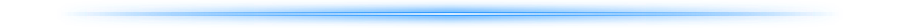

<div align="center">

<picture>
  <source media="(prefers-color-scheme: dark)" srcset="assets/hero-dark.svg">
  <source media="(prefers-color-scheme: light)" srcset="assets/hero-light.svg">
  
</picture>

<sub>This profile reads your GitHub theme. Switch between light and dark and watch me change sides.</sub>

<br><br>



<br><br>

<picture>
  <source media="(prefers-color-scheme: dark)" srcset="assets/divider-dark.svg">
  
</picture>

<br>


<br><br>

<picture>
  <source media="(prefers-color-scheme: dark)" srcset="assets/divider-dark.svg">
  
</picture>

<h3>⚔️ The armory</h3>



<br><br>

<picture>
  <source media="(prefers-color-scheme: dark)" srcset="assets/divider-dark.svg">
  
</picture>

<h3>🧠 Jedi mind tricks that actually work</h3>

</div>

```bash
cc -Wall -Wextra -Werror *.c         # Strike me down and I'll compile cleaner than ever.
valgrind --leak-check=full ./a.out   # I sense a leak in the Force...
norminette                           # I find your lack of norm disturbing.
gdb ./a.out                          # Use the debugger, Padawan.
git push                             # Do or do not. There is no --force.
```

<div align="center">

<br>

<h3>📜 The code of the 1337 Padawan</h3>

*There is no teacher, there is the peer.*<br>
*There is no segfault, there is gdb.*<br>
*There is no "it works on my machine", there is the evaluation.*<br>
*There is no end, there is the next project.*

<br>

**"The greatest teacher, failure is."**<br>
<sub>Yoda, <i>The Last Jedi</i></sub>

<br><br>

<details>
<summary>🔒 <b>A sealed holocron.</b> Click to open it with the Force.</summary>
<br>
🤚 <i>These aren't the bugs you're looking for.</i><br>
<i>Your code compiles now. You can push.</i>
<br><br>
</details>

<!--
  📡 OPEN A COMM CHANNEL
  Uncomment this block and replace YOUR_LOGIN / YOUR_HANDLE / YOUR_EMAIL.

<br>
<a href="https://profile.intra.42.fr/users/YOUR_LOGIN"></a>
<a href="https://www.linkedin.com/in/YOUR_HANDLE"></a>
<a href="mailto:YOUR_EMAIL"></a>
-->

<br><br>

<picture>
  <source media="(prefers-color-scheme: dark)" srcset="assets/footer-dark.svg">
  <source media="(prefers-color-scheme: light)" srcset="assets/footer-light.svg">
  
</picture>

</div>

<!-- Artwork is hand-built SVG. Fonts embedded in the SVGs: Michroma, Chakra Petch, Share Tech Mono (SIL Open Font License). -->
