---

## 🌌 Introduction

  <em>"A long time ago, in a terminal far, far away..."</em>

Greetings, traveler! I am **Zeneb**, a student (Padawan) at **1337**, the coding school where there are no teachers and no lectures, only peer learning, projects, and the Force of curiosity.

I have survived the **Piscine** (100% completed) and I am now crossing the galaxy of the **new Common Core**, one planet at a time.

- 🎓 **School:** 1337 (42 Network)
- 🧑‍🚀 **Rank:** Padawan, Piscine conquered
- 🔭 **Currently exploring:** C and Shell
- 🌱 **Goal:** Become a Jedi Knight of code
- 📫 **Contact:** *add your email / LinkedIn here*

---

## 🗺️ The Galactic Roadmap

  

  🟢 <strong>Green</strong> = conquered &nbsp;|&nbsp; 🔵 <strong>Outlined</strong> = upcoming mission &nbsp;|&nbsp; 🟡 <strong>Dashed ring</strong> = current sector

---

## 🛠️ Languages (My Weapons)

---

## 💬 Words of Wisdom

> **"The greatest teacher, failure is."**
>
> — Yoda, *Star Wars: The Last Jedi*

---

**⭐ May the Force (and the norminette) be with you! ⭐**

